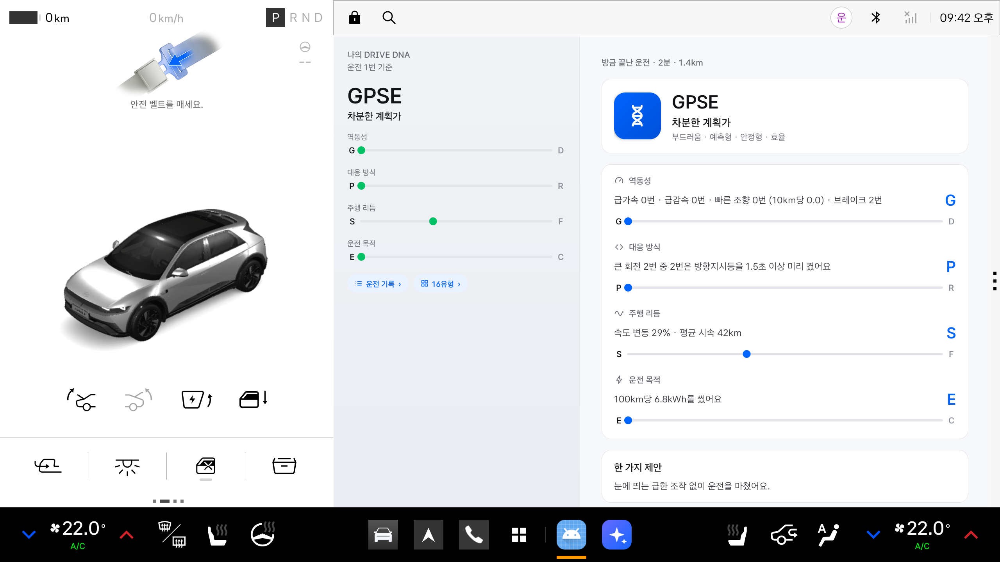

# DRIVE DNA

운전을 마치고 P에 놓으면, 이번 운전의 성향을 네 글자 유형(예: GPSE 차분한 계획가)으로 보여 주는 Pleos Connect 앱입니다. 차 신호(주행거리, 브레이크, 조향각, 방향지시등, 배터리 잔량)만으로 네 개 축을 판정하고, 축마다 무엇을 보고 그렇게 판단했는지 관측 사실을 먼저 보여 줍니다. 근거가 모자란 축은 억지로 정하지 않고 "·"로 보류합니다. 운전이 쌓이면 최근 10번을 모은 "나의 DNA"와 이번 운전이 평소와 어떻게 달랐는지를 보여 줍니다. 쌓인 기록으로는 크루즈·충전·이동 범위·동승·빗길 보조 태그 다섯 개를 붙입니다.



처음 쓰는 분은 [사용설명서](사용설명서.md)를 먼저 보세요. 이 README는 빌드·시연·설계 문서를 다룹니다.

## 네 개 축 (잠정 기준)

| 축 | 앞 / 뒤 | 보는 것 |
|---|---|---|
| 역동성 | G 부드러움 / D 역동적 | 10km당 급가속·급감속·빠른 조향 횟수(속도는 주행거리로 추정) |
| 대응 방식 | P 예측형 / R 반응형 | 큰 회전 전에 방향지시등을 1.5초 이상 미리 켠 비율 |
| 주행 리듬 | S 안정형 / F 유동형 | 움직이는 동안 속도의 변동계수 |
| 운전 목적 | E 효율 / C 편안함 | 100km당 전력(배터리 잔량 감소) |

기준 수치는 검증 전 잠정값이고, 화면에도 "잠정 기준"이라고 적습니다. 결과는 정차(P)에서만 보여 주고, 주행 중에는 말하지도 화면을 바꾸지도 않습니다. 기록은 차 안에만 100개까지 남습니다. 위치는 운전이 끝난 곳 한 점만 차 안에 두고(이동 범위 태그), 경로는 모으지 않으며 화면에는 비율만 보입니다.

## 보조 태그 (잠정 기준)

네 글자 유형은 그대로 두고, 쌓인 기록으로 태그 다섯 개를 정합니다. 결과 화면과 음성은 바뀌지 않고, 나의 DNA 칸의 칩과 P에서 여는 **태그 ›** 화면에만 보입니다. 태그마다 판정, 횟수·비율이 든 근거, 보류 이유가 나옵니다. 근거가 모자라거나 기준 사이면 "보류"입니다.

| 태그 | 앞 / 뒤 | 보는 것 |
|---|---|---|
| 크루즈 | 직접 운전형 / 크루즈 위임형 | 30분 넘고 평균 시속 60km 이상인 장거리 운전 3번 이상의 크루즈 작동 비율 중앙값(15% 이하 / 50% 이상). 크루즈 값을 한 번도 받지 못한 차에서는 숨김 |
| 충전 | 한계 활용형 / 여유 충전형 | 다음 운전의 시작 배터리가 10%p 넘게 오른 때를 충전으로 보고, 충전 3번 이상의 충전 직전 배터리 중앙값(25% 이하 / 40% 이상) |
| 이동 범위 | 루틴형 / 탐험형 | 운전이 끝난 곳을 150m로 묶었을 때 새 장소의 비율(10% 이하 / 30% 이상). 위치가 있는 운전 20번 이상 |
| 동승 | 동승 한결형 / 동승 맞춤형 | 조수석에 사람이 앉은 채 시작한 운전 3번 이상과 평소의 역동성 지수 차이(10% 이하 / 25% 이상) |
| 빗길 | 빗길 한결형 / 빗길 맞춤형 | 와이퍼를 3분 넘게 켠 운전 3번 이상과 평소의 차이(기준은 동승과 같음) |

좋고 나쁨은 없고, 변화의 방향은 판정하지 않습니다.

## 3차: 운전 그래프와 비교

| 기능 | 하는 일 |
|---|---|
| 운전 그래프 | 결과 화면 맨 위에 그 운전의 속도 흐름(최대 40칸)과 평균 점선, 급가속 ▲·급감속 ▼·빠른 조향 ◆ 표시를 보입니다. 사건 수는 역동성 근거의 횟수와 같습니다. 최고 시속 숫자는 보이지 않습니다. 운전 기록 줄 왼쪽에는 작은 그래프가 붙습니다(1·2차 기록은 DNA 타일) |
| 두 운전 비교 | 운전 기록 머리의 **비교**를 켜고 두 줄을 골라 **두 운전 비교**를 누르면, 두 유형 카드(먼저 고른 것 파랑, 다음 초록), 겹친 그래프, 축마다 두 점과 두 근거, "다른 축 n개 · 같은 축 m개"를 보입니다. 우열은 말하지 않습니다 |
| 눈에 띄는 새 결과 | P에 놓은 지 10초 안에 처음 그리는 결과는 네 글자가 차례로 떠오르고 DNA 타일 둘레로 링이 두 번 퍼집니다(한 결과에 한 번, 움직임 줄이기 설정이면 없음). "한 가지 제안" 아래에 들은 음성 문장이 스피커·소리 막대와 함께 남습니다 |
| 바뀐 태그 근거 | 방금 운전으로 태그 판정이나 근거 문장이 바뀌면 태그 카드에 "새로 정해짐" 또는 "방금 운전으로 바뀜"과 "지난: …"이 붙고, 나의 DNA 칸에 "방금 운전으로 태그 근거 n개가 바뀌었어요 ›"가 생깁니다 |

기록 한 줄에는 속도 칸과 사건 칸 두 필드가 더 붙습니다(위치는 더 저장하지 않습니다). 1·2차 기록은 그대로 읽습니다.

## 실행 방법

### 빌드

```bash
export JAVA_HOME=$(/usr/libexec/java_home -v 17 2>/dev/null || echo /opt/homebrew/opt/openjdk@17/libexec/openjdk.jdk/Contents/Home)
export ANDROID_HOME=$HOME/Library/Android/sdk
./gradlew :app:testDebugUnitTest :app:assembleDebug
```

**APK 위치**: 빌드하면 `app/build/outputs/apk/debug/app-debug.apk`가 생깁니다.

### 에뮬레이터에서 시연

```bash
emulator -avd pleos -no-snapshot &      # Cold boot. Quick boot면 VHAL을 못 씀
adb install -r -g app/build/outputs/apk/debug/app-debug.apk
adb forward tcp:8088 tcp:8088           # Virtual Console
python3 scripts/demo.py reset           # 첫 앱 정지, 콘솔 신호 0, 배터리 60kWh, 앱 기록 삭제 후 앱 열기
python3 scripts/demo.py gentle          # 부드러운 운전(약 2분 15초) → GPSE 차분한 계획가
python3 scripts/demo.py dynamic         # 역동적인 운전(약 1분) → DRFC 자유로운 드라이버
python3 scripts/demo.py city            # 시내 운전(약 2분 10초) → GPFE 유연한 길잡이
python3 scripts/demo.py straight        # 회전 없는 운전(약 2분) → G·SE, 대응 방식 판정 보류
python3 scripts/demo.py short           # 15초 운전 → "짧은 운전은 분석하지 않아요"
python3 scripts/demo.py tour            # 전체 연속 시연(약 10분): reset → 위 다섯 개, 사이사이 결과·기록·다시 보기·16유형 화면을 자동으로 넘김
python3 scripts/demo.py seed            # 보조 태그: 샘플 기록 24개(scripts/seed.txt)를 넣고 앱을 다시 연다 → 칩 다섯, 태그 화면 다섯 판정
python3 scripts/demo.py highway         # seed 뒤에: 크루즈를 켠 고속 운전(약 2분 10초) → 태그 화면의 크루즈·충전 근거가 이 운전을 포함한 수로 바뀜
python3 scripts/demo.py compare         # 3차: reset → gentle → dynamic → 운전 기록 → 비교 → 두 줄 → "두 운전 비교"(약 4분)
```

- Virtual Console은 속도를 줘도 주행거리를 늘리지 않습니다. 그래서 스크립트가 0.2초마다 경과 시간으로 계산한 주행거리를 직접 씁니다. 시나리오는 `scripts/scenarios/<이름>.txt`의 구간표이고, 단위 테스트(`DnaTest`)도 같은 표를 재생해 기대 유형을 지킵니다.
- 기어를 D에 두면 Pleos가 "주행 중에는 사용할 수 없습니다"로 앱을 가립니다. P에 놓는 순간 결과 화면과 음성 한 번이 나옵니다.
- 브라우저로 `127.0.0.1:8088` 콘솔 페이지를 열어 둔 채 스크립트를 돌리면, 페이지에 남은 상태가 다시 들어갑니다. 스크립트로 시연할 때는 페이지를 닫으세요.
- 정차 중에는 왼쪽 "나의 DNA" 칸의 **운전 기록 ›**(지난 운전 다시 보기), **16유형 ›**(유형 표), **태그 ›**(보조 태그)를 누를 수 있습니다.
- 시연 빌드는 태그 기준도 낮춥니다(장거리 1분·시속 20km, 와이퍼 30초, 이동 범위 5번, 동승·빗길 2번).

## 테스트 환경과 설정

- Pleos Connect Emulator v2.1.0(Android API 34), 가로 2560×1440(앱 창 1682×1210)
- Pleos Vehicle SDK 2.3.2, Pleos TextToSpeech 3.3.1(온디바이스)
- 권한: `pleos.car.permission.CAR_INFO`·`CAR_DRIVE`·`CAR_LIGHTS`·`CAR_ENERGY`·`CAR_SEATS`·`CAR_WINDOWS`(조회만), `FUSED_LOCATION`(런타임 요청, 끝난 곳 한 점), `TTS_SERVICE`, 알림
- JDK 17, Gradle 8.11.1, AGP 8.8.2, Kotlin 2.0.21, 시연 스크립트는 Python 3(표준 라이브러리만)
- 디버그 빌드는 보류·짧은 운전 기준을 낮춥니다(30초·0.2km, 축 판정 0.3km·회전 2번). 출시 빌드는 3분·1km, 축 판정 2km·회전 3번입니다. 시계는 둘 다 실제 시간입니다.

## 문서

- 기획: `../DRIVE_DNA_자동차_운전성향_보고서.pdf`(공모전 폴더)
- 설계: `docs/superpowers/specs/2026-11-09-drive-dna-design.md`
- 보조 태그 설계: `docs/superpowers/specs/2026-11-10-drive-dna-tags-design.md`, 명세·검증: `specs/002-tags/`
- 3차 설계: `docs/superpowers/specs/2026-11-11-drive-dna-details-design.md`, 명세·검증: `specs/003-drive-graph/`(그래프, 비교, 바뀐 근거, 자막·공개 효과)
- 명세·계획·작업·검증: `specs/001-drive-dna/`
  - `spec.md`, `plan.md`, `data-model.md`, `contracts/ui.md`, `research.md`(신호 측정), `quickstart.md`, `tasks.md`
  - `goldfish-review.md`(설계 문서 리뷰), `approval-gate.md`(구현 전 결정), `verification.md`(에뮬레이터 결과)
- 화면 캡처: `docs/screenshots/`(첫 실행, 주행 중, 결과, 기록, 다시 보기, 16유형, 보류, 짧은 운전, 다크, 세로, 태그 칩, 태그 화면)

## 한계

- **속도는 추정입니다.** SDK에 차속 신호가 없어 주행거리 변화로 계산합니다. SDK는 주행거리를 Float로 주므로 누적 32,768km 이상인 차는 값의 최소 단위가 3.9m를 넘어, 그 운전의 역동성·주행 리듬을 "주행거리 값이 거칠어 판정을 미뤘어요"로 보류합니다. 실차에서 주행거리가 더 거친 단위(예: 0.1km)로 오면 급가속·급감속을 놓칠 수 있습니다. 에뮬레이터 밖에서는 확인하지 못했습니다.
- 서 있거나 후진하며 돌린 핸들(주차)은 회전으로 세지 않습니다.
- **대응 방식은 방향지시등 습관만 봅니다.** 주변 차·차선 정보가 없어 예측 능력을 판정하지 않습니다.
- **운전 목적은 전기차의 배터리 잔량만 봅니다.** 배터리 신호가 없는 차에서는 이 축이 보류됩니다. 도로·기온·속도의 영향이 큽니다.
- 전비 신호는 에뮬레이터에서 확인되지 않아 쓰지 않습니다.
- **보조 태그의 차 신호(크루즈·와이퍼·조수석 착좌·위치)는 에뮬레이터에서만 확인했습니다.** 에뮬레이터는 조수석 착좌를 콘솔 값의 반대로 줍니다. 실차 값과 몇 주 동안 쌓인 실제 기록에서의 판정 빈도는 확인하지 못했습니다.
- 동승은 운전 시작 때 조수석만 봅니다. 뒷좌석 동승자와 도중에 탄 사람은 세지 않습니다.
- 운전자를 구분하지 않고 한 사람으로 봅니다.
- **그래프는 주행거리로 추정한 속도입니다.** 앱이 받는 주행거리 간격(약 1초)마다 한 표본이라, 짧은 급정거는 그래프보다 사건 표시(▼)로 더 잘 보입니다. `seed`의 그래프 모양은 기록의 평균 시속·속도 변동으로 만든 시연 준비값입니다.
- 앱이 운전 도중에 처음 켜지면 그 운전은 기록하지 않습니다.
- 상시 포그라운드 서비스(`specialUse`)가 Pleos App Market 심사에서 허용되는지 확인하지 못했습니다.
