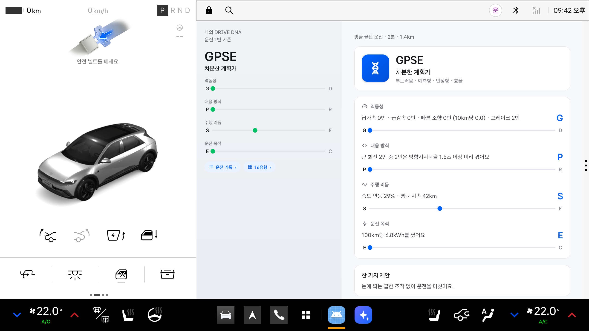
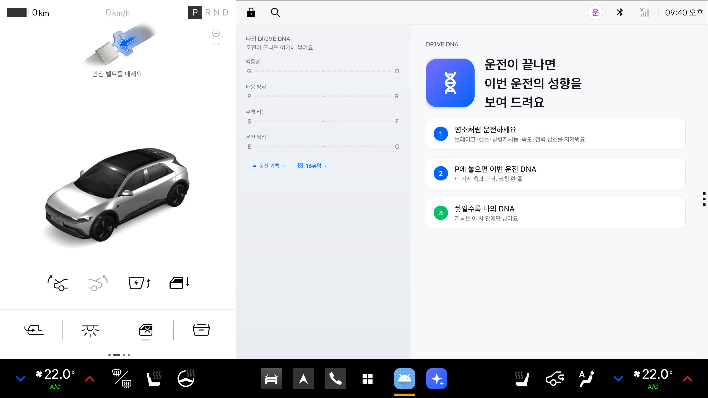
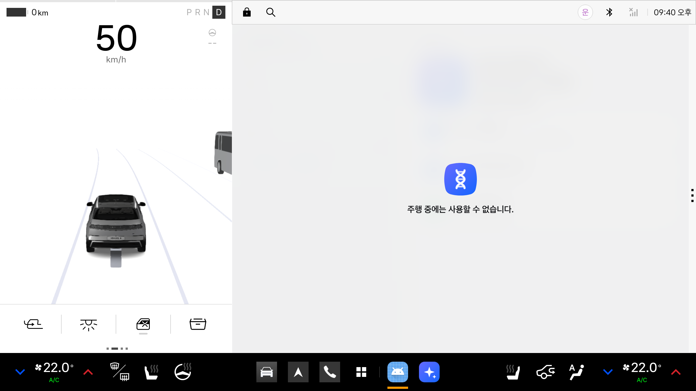
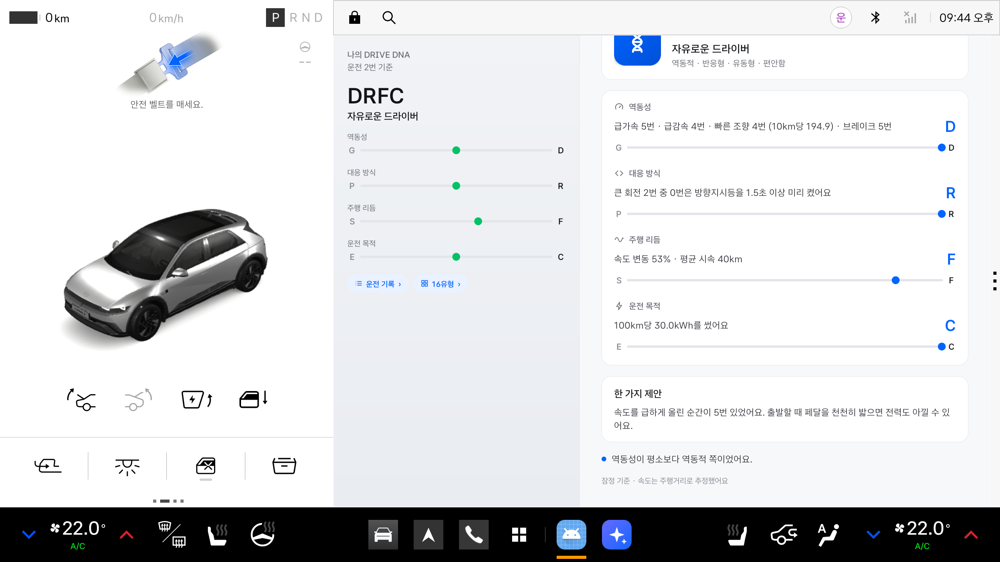
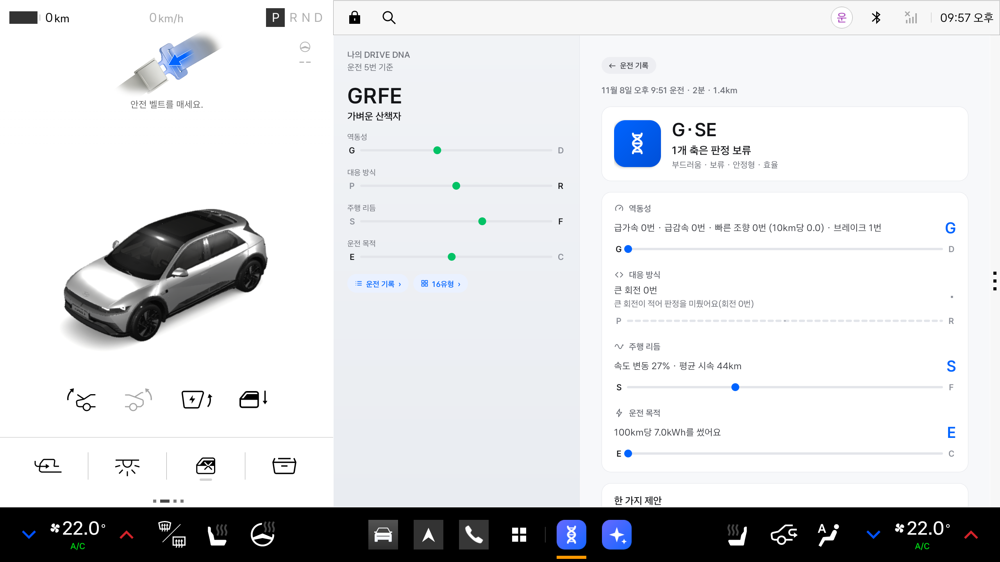
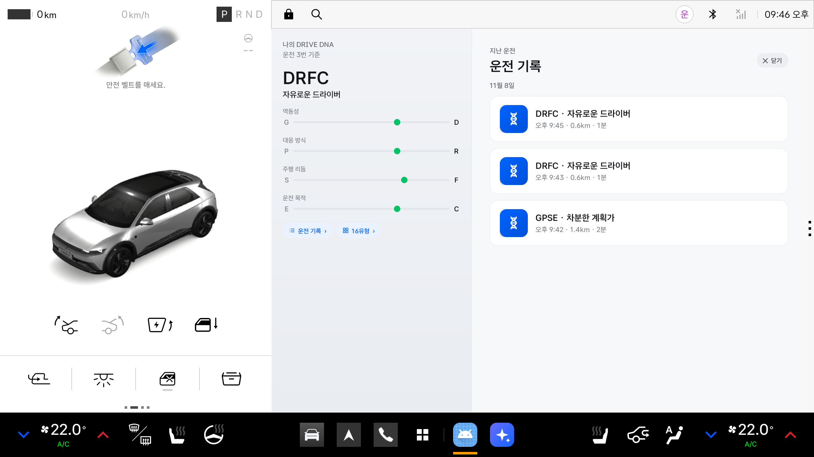
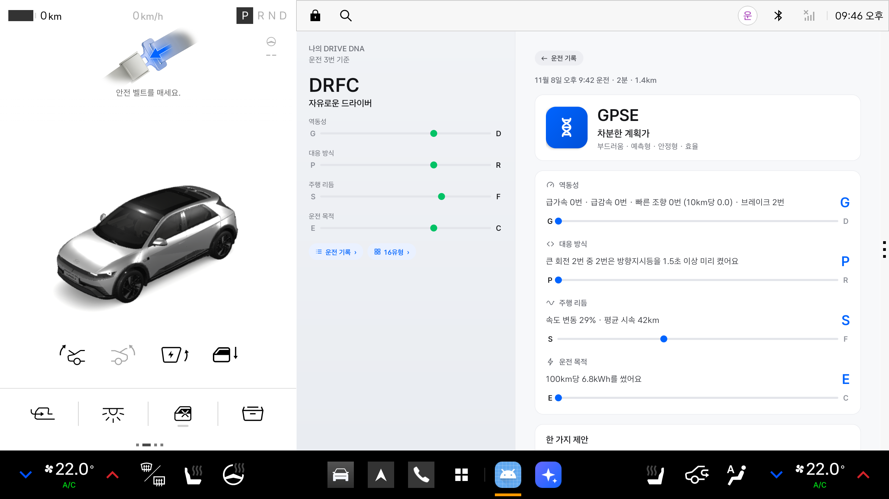
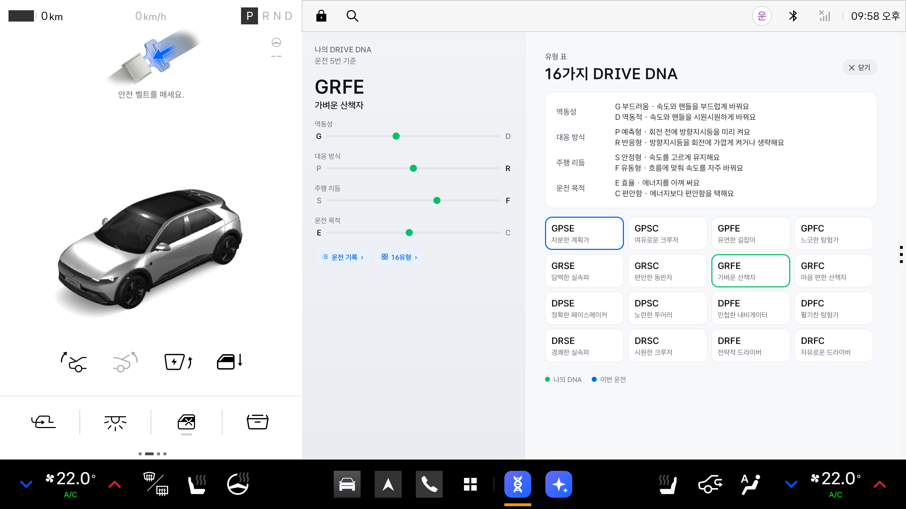

# DRIVE DNA — 사용설명서

> 운전을 마치고 P에 놓으면, 이번 운전이 어떤 성향이었는지 **네 글자**로 알려 드리는 Pleos Connect 앱이에요.



## 이런 분께 맞아요

- 내 운전 습관이 어떤지 궁금한 분
- 점수를 매기는 앱은 부담스러운 분
- 운전이 쌓이면서 내 운전이 어떻게 바뀌는지 보고 싶은 분

DRIVE DNA는 운전을 **좋다·나쁘다로 가리지 않아요.** 점수도 순위도 없어요. 무엇을 보고 그렇게 판단했는지(관측 사실)를 먼저 보여 드리고, 근거가 모자라면 억지로 정하지 않아요.

## 세 단계로 동작해요

1. **평소처럼 운전하세요.** 주행 중에는 말하지도 화면을 바꾸지도 않아요. 주행거리, 브레이크, 핸들, 방향지시등, 배터리 같은 차 신호만 조용히 지켜봐요.
2. **P에 놓으면 이번 운전 DNA.** 네 글자 유형과 그 근거, 한 가지 제안을 화면에 보여 드리고, 음성으로 한 번 짧게 알려 드려요.
3. **쌓일수록 나의 DNA.** 최근 10번의 운전을 모아 "나의 DNA"를 보여 드리고, 이번 운전이 평소와 어떻게 달랐는지도 알려 드려요.

## 네 글자 읽는 법

네 글자는 네 가지 축을 차례로 나타내요. 축마다 두 글자 중 하나가 나와요.

| 자리 | 축 | 앞 글자 | 뒤 글자 | 무엇을 보나요 |
|---|---|---|---|---|
| 첫째 | 역동성 | **G** 부드러움 | **D** 역동적 | 속도를 급하게 올리거나 줄인 횟수, 핸들을 빠르게 크게 돌린 횟수(10km당) |
| 둘째 | 대응 방식 | **P** 예측형 | **R** 반응형 | 큰 회전 전에 방향지시등을 1.5초 이상 미리 켠 비율 |
| 셋째 | 주행 리듬 | **S** 안정형 | **F** 유동형 | 달리는 동안 속도가 얼마나 자주 오르내렸는지 |
| 넷째 | 운전 목적 | **E** 효율 | **C** 편안함 | 100km를 달린다면 쓰게 될 전기(kWh) |

예를 들어 **GPSE**는 부드럽고(G), 방향지시등을 미리 켜고(P), 속도를 고르게 유지하고(S), 에너지를 아껴 쓴(E) 운전이에요. 별칭은 "차분한 계획가"예요.

- **"·"는 판정 보류예요.** 근거가 모자라면 그 자리를 비워 둬요. 예를 들어 큰 회전이 거의 없던 운전은 대응 방식을 판단할 수 없어 "G·SE"처럼 나와요. 이유는 화면에 함께 적혀 있어요.
- **막대는 어느 쪽에 가까운지 보여 줘요.** 점이 가운데에서 끝으로 갈수록 그 성향이 뚜렷해요.
- **기준은 잠정값이에요.** 아직 많은 운전으로 검증하지 않은 값이라 화면에 "잠정 기준"이라고 적어 둬요.

### 16가지 유형

| | E 효율 | C 편안함 |
|---|---|---|
| **GPS** | GPSE 차분한 계획가 | GPSC 여유로운 크루저 |
| **GPF** | GPFE 유연한 길잡이 | GPFC 느긋한 탐험가 |
| **GRS** | GRSE 담백한 실속파 | GRSC 편안한 동반자 |
| **GRF** | GRFE 가벼운 산책자 | GRFC 마음 편한 산책자 |
| **DPS** | DPSE 정확한 페이스메이커 | DPSC 노련한 투어러 |
| **DPF** | DPFE 민첩한 내비게이터 | DPFC 활기찬 탐험가 |
| **DRS** | DRSE 경쾌한 실속파 | DRSC 시원한 크루저 |
| **DRF** | DRFE 전략적 드라이버 | DRFC 자유로운 드라이버 |

GPSE·GPSC·DRFE·DRFC 네 가지는 기획 보고서의 예시이고, 나머지 12가지는 이 앱이 지은 이름이에요.

## 설치하고 처음 열기

**필요한 것**: Pleos Connect가 들어간 차, 또는 Pleos Connect Emulator v2.1.0(Android API 34). 운전 목적 축(E/C)은 배터리 신호가 있는 전기차에서만 판정돼요.

1. **설치**: 아직 Pleos App Market에는 없어서 APK 파일을 직접 설치해요. 컴퓨터에 차(또는 에뮬레이터)를 연결하고 아래를 실행하세요.

   ```bash
   adb install -r -g 앱파일.apk
   ```

   APK를 직접 만들려면 [README의 "빌드"](README.md#빌드)를 따르세요.
2. **열기**: 앱 목록에서 **DRIVE DNA**를 누르세요. 에뮬레이터에서는 명령으로도 열 수 있어요.

   ```bash
   adb shell am start --user 10 -n kr.skku.drivedna/.MainActivity
   ```

3. **알림 허용**: 처음 열 때 알림 권한을 물어요. 허용하면 P에 놓았을 때 결과가 알림으로도 떠요.



한 번 열어 두면 앱 화면을 닫아도 뒤에서 운전을 지켜봐요. 그동안 알림 영역에 "운전을 지켜보는 중"이 보여요. 차를 다시 켜면(부팅) 앱을 열지 않아도 알아서 시작해요.

## 화면 둘러보기

가로 화면은 왼쪽에 **나의 DNA**, 오른쪽에 **지금 상황**이 나와요. 세로 화면에서는 위가 지금 상황, 아래가 나의 DNA예요. 차의 라이트·다크 설정을 그대로 따라가요.

### 운전 중

기어가 D·N이면 Pleos가 "주행 중에는 사용할 수 없습니다"로 앱을 가리고, R이면 후방 카메라 화면이 덮어요. 앱 안에서도 "운전 중이에요"만 보이고, 나의 DNA 칸의 버튼은 흐려져 눌리지 않아요.



운전 도중에 앱을 처음 켰다면 그 운전은 기록하지 않아요("이번 운전은 기록하지 않아요. 다음 운전부터 지켜볼게요.").

### P에 놓으면: 이번 운전 DNA

위에서부터 이렇게 나와요.

1. **작은 제목**: "방금 끝난 운전 · 2분 · 1.4km". 끝난 지 10분이 지난 뒤 앱을 열면 그 운전의 날짜와 시각이 나와요.
2. **유형 카드**: 네 글자, 별칭, 네 글자의 이름(예: 부드러움 · 예측형 · 안정형 · 효율)
3. **축 네 줄**: 축마다 관측 사실(예: "급가속 0번 · 급감속 0번 · 빠른 조향 0번")이 먼저, 판정 글자가 오른쪽에, 그 아래 막대가 나와요.
4. **한 가지 제안**: 이번 운전에서 가장 두드러진 점 하나와 부드러운 제안. 특별히 두드러진 게 없으면 "눈에 띄는 급한 조작 없이 운전을 마쳤어요."
5. **평소와 다른 점**: 나의 DNA와 크게 다른 축이 있으면 한 줄로 알려 드려요(예: "역동성이 평소보다 역동적 쪽이었어요.").

음성으로 한 번 말하고(예: "이번 운전은 G P S E, 차분한 계획가 쪽이었어요."), 알림 "이번 운전 DNA: GPSE"가 떠요. 이 알림은 다음 운전을 시작하면 사라져요.



### 판정을 미룬 축

근거가 모자란 축은 글자 대신 "·", 막대는 회색 점선이에요. 왜 미뤘는지 한 줄로 알려 드려요.

| 이유 문장 | 이런 때 |
|---|---|
| 큰 회전이 적어 판정을 미뤘어요 | 핸들을 크게 돌린 회전이 적은 운전(직진 위주) |
| 거리가 짧아 판정을 미뤘어요 | 달린 거리가 짧은 운전 |
| 움직인 시간이 짧아 판정을 미뤘어요 | 서 있던 시간이 대부분인 운전 |
| 배터리 사용량을 알 수 없어 판정을 미뤘어요 | 배터리 신호가 없는 차(전기차가 아님)이거나 배터리가 줄지 않은 운전 |
| 조향 신호가 없어 / 조향·방향지시등 신호가 없어 판정을 미뤘어요 | 차가 그 신호를 주지 않을 때 |
| 주행거리 값이 거칠어 판정을 미뤘어요 | 누적 주행거리가 아주 큰 차(아래 "자주 묻는 질문") |



### 짧은 운전

3분 또는 1km가 안 되는 운전은 분석하지 않아요. "짧은 운전은 분석하지 않아요"와 운전 길이만 보이고, 음성이 없으며 운전 기록 목록에도 나오지 않아요.

### 나의 DNA 칸

- 최근 10번의 분석된 운전을 축마다 평균 내서 보여 줘요. 운전이 한 번뿐이면 그 운전과 같아요.
- 위에는 "운전 n번 기준", 가운데에는 네 글자와 별칭, 아래에는 축 막대 네 개가 있어요.
- **운전 기록 ›**, **16유형 ›** 버튼으로 다른 페이지를 열어요. 세로 화면에서는 이 버튼이 칸 위쪽에 있어요.

### 운전 기록과 다시 보기

**운전 기록 ›**을 누르면 분석된 운전이 날짜별로(최신이 위) 나와요. 줄을 누르면 그 운전의 결과를 다시 볼 수 있어요. 다시 볼 때는 저장된 관측값을 지금 기준으로 다시 판정하고, 평소와 다른 점은 그 운전 전까지의 나의 DNA와 비교해요. "←  운전 기록"이나 뒤로 가기로 목록에 돌아가요.

| 목록 | 다시 보기 |
|---|---|
|  |  |

### 16유형 표

**16유형 ›**을 누르면 네 축의 뜻과 16가지 유형이 나와요. 나의 DNA는 **초록** 테두리, 열기 직전에 보던 운전은 **파랑** 테두리예요. 판정을 미룬 축이 있으면 맞는 유형을 모두 표시해요.



## 알아 두면 좋은 규칙

- 결과와 음성은 **P에 놓은 뒤에만** 나와요. 운전 중에는 말하지 않아요.
- 3분 또는 1km가 안 되는 운전은 분석하지 않아요.
- 한 번의 운전은 길·날씨·교통에 따라 흔들려요. 내 성향은 여러 운전을 모은 **나의 DNA**로 보세요.
- 서 있거나 후진하며 돌린 핸들(주차)은 회전으로 세지 않아요.
- 핸들을 90° 이상 돌린 경우만 "큰 회전"으로 세요.

## 자주 묻는 질문

**점수나 등급이 있나요?**
없어요. 유형은 좋고 나쁨이 아니라 운전 습관을 설명하는 이름이에요.

**방향지시등을 켰는데 R(반응형)이 나와요.**
회전을 시작하기 **1.5초 이상 전에** 켜야 "미리 켰다"로 세요. 핸들을 돌리면서 켜면 미리 켠 것으로 보지 않아요.

**전기차가 아니에요.**
배터리 신호가 없으면 운전 목적 축(E/C)은 "·"로 보류돼요. 나머지 세 축은 그대로 판정해요.

**역동성과 주행 리듬이 늘 보류돼요.**
이 앱은 차속 신호가 없어 주행거리 변화로 속도를 추정해요. 차가 주는 주행거리 값의 정밀도 때문에, 누적 주행거리가 약 32,768km를 넘는 차에서는 속도를 믿을 만하게 추정할 수 없어 이 두 축을 보류해요.

**기록은 어디에 남나요?**
차 안의 앱 저장소에만 최근 100개가 남아요. 위치나 경로는 모으지 않고, 밖으로 보내지도 않아요. 앱을 지우면 기록도 함께 지워져요.

**지난 운전을 다시 보니 처음과 결과가 달라요.**
다시 보기는 저장된 관측값을 지금 기준으로 다시 판정해요. 앱이 업데이트되어 기준이 바뀌면 결과가 달라질 수 있어요.

**화면 위에 빨간 띠 "차 신호를 받지 못하고 있어요"가 보여요.**
차와 연결되지 않았다는 뜻이에요. 앱이 10초마다 다시 연결해요. 계속 보이면 앱을 다시 열어 보세요.

## 에뮬레이터에서 해 보기

에뮬레이터의 Virtual Console은 속도를 줘도 **주행거리를 늘리지 않아요.** 그래서 콘솔 페이지에서 손으로 운전하면 대부분 "짧은 운전"으로 끝나요. 대신 운전을 흉내 내는 시연 스크립트를 쓰세요(Python 3 필요).

```bash
adb forward tcp:8088 tcp:8088           # 에뮬레이터를 켤 때마다
python3 scripts/demo.py reset           # 처음 상태로(앱 기록 삭제)
python3 scripts/demo.py gentle          # 부드러운 운전 약 2분 15초
```

처음부터 끝까지 한 번에 보려면 `python3 scripts/demo.py tour`를 실행하세요(약 10분). 다섯 가지 운전을 차례로 하고, 사이사이 결과·운전 기록·다시 보기·16유형 화면을 자동으로 넘겨 보여 줘요.

| 시나리오 | 어떤 운전 | 나오는 결과 |
|---|---|---|
| `gentle` | 천천히 출발하고, 방향지시등을 미리 켜고 회전 | GPSE 차분한 계획가 |
| `dynamic` | 급출발·급정거, 방향지시등 없이 빠른 회전 | DRFC 자유로운 드라이버 |
| `city` | 서고 가기를 되풀이, 방향지시등은 미리 켬 | GPFE 유연한 길잡이 |
| `straight` | 회전 없이 곧게 | G·SE(대응 방식 보류) |
| `short` | 15초 운전 | 짧은 운전 |

알아 둘 점:
- 시연용(디버그) 빌드는 짧은 운전 기준이 30초·0.2km로 낮아요. 시간은 실제로 흘러요.
- 스크립트를 돌릴 때는 브라우저의 콘솔 페이지(`127.0.0.1:8088`)를 닫아 두세요. 열려 있으면 페이지에 남은 상태가 차에 다시 들어가 결과가 틀어질 수 있어요.
- 시나리오가 끝나면 P에서 결과 화면과 음성이 나와요. 시나리오를 차례로 돌리면 나의 DNA와 운전 기록이 쌓이는 것도 볼 수 있어요.

## 알아 두면 좋은 한계

- 속도는 주행거리 변화로 **추정**해요. 실제 차에서 주행거리 신호가 어떻게 오는지는 아직 확인하지 못했어요.
- 대응 방식(P/R)은 주변 차·차선 정보가 없어 **방향지시등을 미리 켰는지만** 봐요. 예측 능력 자체를 판정하지는 않아요.
- 운전 목적(E/C)은 **전기 사용량만** 봐요. 길·기온·속도의 영향을 많이 받아요.
- 운전자를 구분하지 않고 한 사람으로 봐요.
